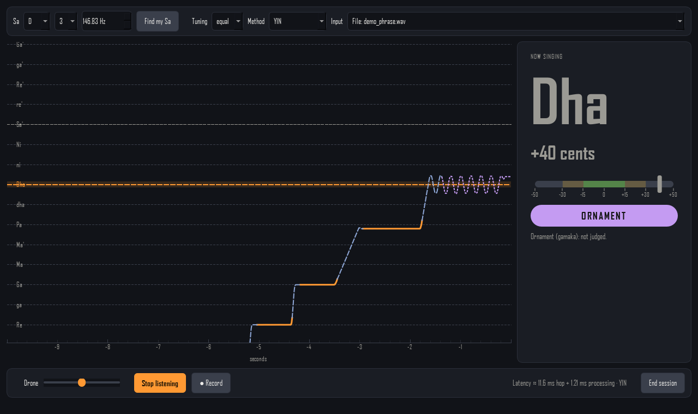

# Swara-Aware

**Free, open-source, real-time pitch feedback for learner singers of Indian classical
music.** Swara-Aware listens through your laptop microphone, finds your pitch, and shows
which swara you are singing and how many cents sharp or flat you are, measured from
**your own Sa**. A tanpura-style drone gives you a reference, and deliberate glides
(meend) and ornaments (gamaka) are never marked as mistakes.

Fundamentals of Audio Engineering course project, Group 5: Swarit Kumar (2023540),
Hritik Raj (2023245).



*Screenshot placeholder: rendered offscreen from `data/demo_phrase.wav`. Replace it with
one from a real singing session.*

## Why

Singing in tune needs someone to listen. Many learners have no teacher nearby. Ordinary
tuners use fixed Western note names rather than the singer's Sa, and they flag every
meend as wrong. Swara-Aware is software only and runs on an ordinary laptop.

## Features

- **Your own Sa.** Pick a note, type a frequency, or hum for 3 seconds and let *Find my
  Sa* set it.
- **Swaras in three octaves** (mandra, madhya, taar), komal and tivra included, in equal
  or just tuning.
- **Live display:** a scrolling pitch trace on a swara ladder, a big swara readout, a
  cents meter, and a status chip (in tune, close, sharp, flat, gliding, ornament, silent).
- **Ornament-aware judging:** only held notes count. Glides and gamakas are shown but
  never scored.
- **Tanpura-style drone** (Pa/Ma, Sa, Sa, low Sa) made by additive synthesis, with a
  volume control.
- **Four pitch detectors written from scratch** in numpy, switchable live: FFT peak,
  FFT + Harmonic Product Spectrum, autocorrelation, and YIN.
- **Session summary:** in-tune % per swara, CSV export of the pitch track, plots, and an
  optional WAV recording.
- **Reproducible evaluation:** six experiments, one command, fixed seed.

## Install

You need Python 3.10 or newer.

```powershell
# Windows (PowerShell)
cd swara-aware
python -m venv .venv
.venv\Scripts\Activate.ps1          # if blocked: Set-ExecutionPolicy -Scope CurrentUser RemoteSigned
python -m pip install --upgrade pip
pip install -r requirements.txt
```

```bash
# macOS / Linux
cd swara-aware
python3 -m venv .venv
source .venv/bin/activate
python -m pip install --upgrade pip
pip install -r requirements.txt
```

Linux also needs PortAudio: `sudo apt install libportaudio2`. On macOS, allow
microphone access for your terminal (System Settings → Privacy & Security →
Microphone).

## Run the app

> 🎧 **Use headphones when the drone is on.** From the laptop speakers, the microphone
> hears the drone's strong Sa and Pa and the tracker may follow it instead of your
> voice. In a simulated test (`scripts/demo_logic.py --drone-bleed -6`), a held Pa was
> read as low Sa. Every evaluation script runs with the drone off.

```bash
python scripts/run_app.py                        # microphone
python scripts/run_app.py --wav recording.wav    # play a file through the same pipeline
```

`python -m swara_aware` works too, if `src` is on the path: `$env:PYTHONPATH="src"` in
PowerShell, `PYTHONPATH=src` on macOS/Linux. The options are `--wav FILE`, `--loop`,
`--sa C#3` and `--method yin|autocorr|fft_peak|fft_hps`.

**Analyse a recording from inside the app:** click **Open audio file…** in the top
bar and choose a WAV (FLAC/OGG also work). The file is resampled if needed, analysed in
real time and, with **Play aloud** ticked, played through the speakers. Tick **Loop**
to repeat it. Switch back to the microphone in the **Input** dropdown at any time.

No microphone or singer? Make the synthetic demo recording and play it:

```bash
python scripts/make_demo_wav.py
python scripts/run_app.py --wav data/demo_phrase.wav --loop
```

The step-by-step guide for learners is in [docs/user_guide.md](docs/user_guide.md).

## Run the tests

```bash
python -m pytest
```

The suite has 87 tests and takes about 20 s. The GUI test runs offscreen and is skipped
if PySide6 is missing. Each run ends with a **measurement report**: the error of every
estimator on sines, harmonic tones, missing fundamentals and noisy tones.

## Run the experiments

```bash
python scripts/run_all_experiments.py            # all six, about 30 s
python scripts/run_all_experiments.py --only E2  # just one
```

This writes CSVs and PNGs to `results/` and a report with tables and findings to
[results/RESULTS.md](results/RESULTS.md). The random seed is fixed (2026) and the drone
is never played. Key results:

| Experiment | Result |
|---|---|
| E1 accuracy, synthetic tones | All methods < 0.5 cents on harmonic tones. With the fundamental missing, FFT peak gets the octave wrong on 96% of frames and HPS on 75%; autocorrelation and YIN on 0%. HPS fails on pure sines (81%). |
| E2 noise | All methods are 100% within 25 c down to 10 dB SNR. YIN answers "unvoiced" below about 7 dB (threshold 0.15). FFT peak is the most robust to white noise. |
| E3 latency | Processing about 0.2 ms per frame (under 3% of the 11.6 ms budget). The new swara appears 33–68 ms after a note change. Estimated mic-to-display about 150–180 ms, mostly sound-card buffering (an estimate, not measured physically). |
| E4 real voice | Not run yet: add recordings to `data/voice/`. |
| E5 ornament logic | Glide frames wrongly flagged: 4.8% (naive tuner: 67%); gamaka frames: 1.0% (naive: 76%). 95% of notes sung 30–45 c off are flagged. |
| E6 sensitivity | Frame 1024 → 4096: median error 2.6 → 1.0 c, latency 29 → 117 ms. |

How each method works is explained in [docs/algorithms.md](docs/algorithms.md). A
five-minute presentation plan is in [docs/demo_script.md](docs/demo_script.md).

## Other scripts

| Command | What it does |
|---|---|
| `python scripts/demo_dsp.py [--synth\|--wav F]` | Waveform, RMS in dBFS, spectrum and spectrogram → `results/demo_dsp.png` |
| `python scripts/compare_pitch.py [--wav F]` | All methods + pYIN on a glide (and a recording) → `results/compare_pitch.png` |
| `python scripts/demo_logic.py [--mode just] [--drone-bleed -6]` | Synthetic phrase through YIN and the ornament logic → trace, accuracy chart, CSV |
| `python scripts/make_demo_wav.py` | Writes the demo recording `data/demo_phrase.wav` |

## Repository layout

```
swara-aware/
  src/swara_aware/
    config.py        every tunable default (one frozen dataclass)
    dsp.py           framing, Hann window, RMS/dBFS, FFT, spectrogram, silence gate, SNR
    synth.py         test signals: sine, voice-like tone, glides, contours, white/pink noise
    audio_io.py      microphone, live input stream, WAV files
    pitch/           base.py, fft_peak.py, autocorr.py, yin.py, reference.py (pYIN)
    swara.py         cents from Sa, swaras, tunings, note names, Find my Sa
    ornament.py      stable / glide / ornament labelling
    session.py       judged held notes, statistics, CSV, plots
    drone.py         tanpura-style drone
    app/             live PySide6 + pyqtgraph app (worker thread, widgets, dialogs)
    eval/            experiments E1–E6 and the RESULTS.md generator
  tests/             pytest suite
  scripts/           runnable demos, the app launcher, run_all_experiments.py
  data/              your recordings (data/voice/, data/noise/), demo WAV
  results/           experiment CSVs, PNGs, RESULTS.md; sessions/ for recordings
  docs/              algorithms.md, user_guide.md, demo_script.md, screenshot
```

## Limitations

- **Pitch only.** Swara-Aware says nothing about voice quality (timbre), rhythm (laya)
  or expression.
- **Accuracy depends on the microphone and the room.** Noisy rooms, distant microphones
  and loud breathing reduce accuracy. YIN prefers to say "silent" rather than guess when
  the SNR falls below about 7 dB.
- **The ornament thresholds were tuned on our limited material,** mostly synthetic
  contours and very few real recordings. Meends slower than 200 cents/s are treated as
  held notes and judged. Gamakas slower than about 3 Hz are not recognised. Labels lag
  the voice by about 0.1–0.15 s.
- **pYIN is only a reference.** Where we compare with librosa's pYIN on real voice, a
  disagreement means one of the two is wrong, not necessarily ours.
- **Most evaluation is synthetic.** The real-voice experiment (E4) needs recordings in
  `data/voice/`, and the mic-to-display latency was estimated from components, not
  measured physically.
- **It does not replace a teacher.** It can tell you that you are 20 cents flat; it
  cannot teach raga grammar, phrasing or voice production.

## Credits

- Swarit Kumar and Hritik Raj (Group 5), Fundamentals of Audio Engineering.


