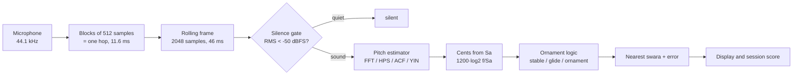
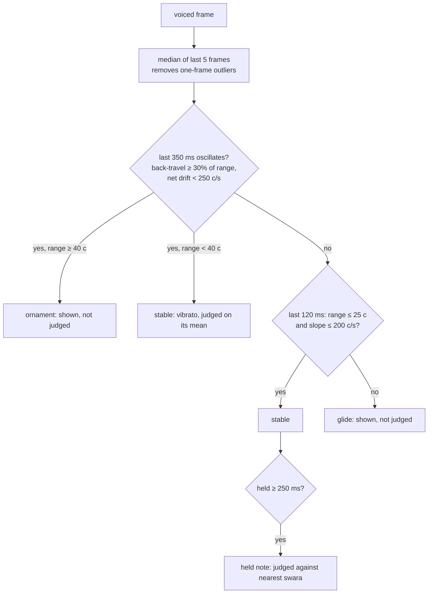

# How Swara-Aware works: the algorithms

This document explains every processing step: what it does in simple words, how it
works, a small diagram, and where it is strong or weak. All of it is written from scratch
with numpy in `src/swara_aware/`. Numbers quoted here come from `results/RESULTS.md`
(`python scripts/run_all_experiments.py`).

## 1. The pipeline at a glance



- **Sampling.** The sound card measures air pressure 44 100 times a second. A sung note
  of 220 Hz therefore repeats about every 200 samples.
- **Framing.** We analyse the most recent 2048 samples (46 ms) and move forward by 512
  samples (one *hop*, 11.6 ms) each time, so consecutive frames overlap by 75%. The
  hop is the real-time budget: each frame must be processed in under 11.6 ms. Our
  methods take about 0.2 ms (E3).
- **Silence gate.** RMS = sqrt(mean(x²)) measures loudness; in dBFS, 0 is full scale.
  Frames quieter than −50 dBFS are called silent, so we never show a pitch for room hiss.

## 2. FFT peak picking (`pitch/fft_peak.py`)

**Idea.** A sung note is a stack of sine waves: the fundamental f0 and harmonics at
2f0, 3f0 and so on. The Fourier transform shows how strong each frequency is. Take the
strongest peak between 70 and 1000 Hz and call it the pitch.

```
 magnitude
   │   █                       window → zero-pad ×4 → FFT → |X(f)|
   │   █   █                   pick the highest bin in [fmin, fmax]
   │   █   █   █               refine with a parabola on log|X|
   │   █   █   █   █  ▂
   └───┴───┴───┴───┴──┴── f
      f0  2f0 3f0 4f0
```

**Steps.**
1. Remove the mean and multiply by a Hann window, which tapers the frame edges and
   reduces spectral *leakage*.
2. Zero-pad to 4× length and take the FFT. Zero-padding does not add real resolution,
   but it samples the spectrum more finely.
3. Find the largest bin between fmin and fmax.
4. **Parabolic interpolation.** Fit a parabola through the peak bin and its two
   neighbours (in log magnitude) and take its vertex. One bin is 21.5 Hz, about 170
   cents at 220 Hz; the parabola brings this below 1 cent on clean tones (E1).
5. **Confidence** = 1 − median/peak magnitude. A clear peak gives about 1; noise gives
   about 0.65. Below 0.8 the frame is unvoiced.

**Strengths.** Very precise on clean tones (E1: 0.06 c on sines, 0.3 c on harmonic
tones), and the most robust to white noise. Each bin collects energy from a narrow band,
so broadband noise hurts little (E2: 100% within 25 c even at 0 dB white noise).

**Failure cases.** It reports the *loudest* harmonic, which is not always the
fundamental. Vowel formants and small laptop microphones often make the 2nd harmonic
strongest, giving an **octave error**. When the fundamental is missing it fails
completely (E1: 96% gross errors). Pink (low-frequency-heavy) noise can also fool its
voicing decision.

## 3. Harmonic Product Spectrum (HPS) (the `use_hps` option)

**Idea.** Compress the spectrum by 2, 3 and 4 and multiply the copies. Only at f0 do
all the harmonics line up (f0, 2f0, 3f0, 4f0 land on the same bin), so the product
peaks at the fundamental even when f0 itself is weak.

```
S(f)    : f0 2f0 3f0 4f0        product = S(f)·S(2f)·S(3f)·S(4f)
S(2f)   : 2f0 4f0 ...           (added in the log domain)
S(3f)   : 3f0 ...               → largest at f = f0
```

**Strengths.** Fixes the octave errors caused by a *weak* fundamental (the tests show
all four errors fixed). It is also the most precise method on harmonic tones in noise
(E6).

**Failure cases.** It **needs harmonics**. On a pure sine (a whistle, or a very pure
"oo") the product has no strong value anywhere, so the answer is random (E1: 81% gross
errors). It also fails on a *missing* fundamental (75% gross), because the f0 bin it
multiplies in is empty.

## 4. Autocorrelation (`pitch/autocorr.py`)

**Idea.** A periodic signal looks like itself when shifted by one period T. Correlate
the frame with delayed copies of itself; the first strong peak gives T, and f0 = fs / T.

```
r(τ) │█
     │█          ▄█▄          ▄█▄          peaks at τ = T, 2T, 3T ...
     │█▄       ▄█   █▄      ▄█   █▄        choose the FIRST strong one
     │  ▀▄▄▄▄▄▀       ▀▄▄▄▄▀       ▀
     └───────────┴────────────┴──── τ (lag, samples)
                 T            2T
```

**Steps.**
1. **Wiener–Khinchin.** The autocorrelation is the inverse FFT of the power spectrum
   |X|². Zero-pad to 2N so the result does not wrap around. This costs O(N log N)
   instead of O(N²).
2. **Normalise** each lag by the energy of the two overlapping parts. A perfect period
   then scores 1 at every multiple of T.
3. Search lags from fs/fmax to fs/fmin. Take the highest point of each positive
   *lobe*, so small noise ripples on the shoulder of a broad peak are ignored.
4. Choose the **first** lobe peak that is at least 0.9× the best one. Peaks at 2T and 3T
   are nearly as high, and choosing the highest would give an octave-low error.
5. Refine T with parabolic interpolation. **Confidence** = peak height; below 0.5 the
   frame is unvoiced.

**Strengths.** It finds the *repetition period*, so a missing fundamental is no problem
(E1: 0% gross errors). It gives no false pitch on noise (Stage 2 tests: 0% on loud white
and pink noise).

**Failure cases.** Less precise than FFT methods on pure sines in white noise, because it
uses the whole band, noise included. It degrades at 0 dB (E2: 70% white, 59% pink). It
was also the slowest to settle after a sudden note change (E3: 184 ms until stable,
against 57–68 ms for the others), apparently because frames that straddle the change
give wavering periods.

## 5. YIN (`pitch/yin.py`), de Cheveigné and Kawahara (2002)

**Idea.** Instead of looking for a peak of *similarity*, look for a dip of
*difference*: d(τ) = Σ (x[j] − x[j+τ])², which is 0 for a perfect period. Then normalise
it so that one fixed threshold works for every note and loudness.

```
d'(τ) 1 ┤▀▄       ▄▀▀▄         ▄▀▀▄
        │  ▀▄    ▄▀    ▀▄     ▄▀    ▀▄
 0.15 ┄┄┼┄┄┄▀▄┄┄▄▀┄┄┄┄┄┄┄▀▄┄┄▄▀┄┄┄┄┄┄  ← absolute threshold
        │     ▀▀            ▀▀
        └──────┴──────────────┴──── τ
               T  (first dip below 0.15 = the period)
```

**Steps.**
1. **Difference function** d(τ). Computed fast with one FFT: d = E(x₀) + E(x_τ) − 2·r(τ).
2. **Cumulative mean normalised difference (CMNDF):** d'(τ) = d(τ) / ((1/τ)·Σ_{j≤τ} d(j)),
   with d'(0) = 1. This removes the trivial dip at τ = 0. It makes d' ≈ 1 for noise and
   near 0 at a true period, whatever the loudness. Because each value is judged against
   the average of all shorter lags, we can take the *first* good dip (the true period)
   rather than the deepest, which avoids octave-low errors.
3. **Absolute threshold** (default 0.15): the first lag where d' < 0.15 marks the dip.
   We take the minimum of that whole dip (a small robustness change from the paper,
   which slides to the first local minimum and can stop on a noise ripple).
4. **Parabolic interpolation** on d(τ) for a fractional period.
5. **Confidence** = 1 − d'(τ). If no dip goes below the threshold, the frame is unvoiced.

**Strengths.** Very precise (E1: 0.01 c), handles a missing fundamental, and gives no
false pitch on noise. On noisy frames it says "unvoiced" rather than guessing wrong,
which is the safest behaviour for a learner.

**Failure cases.** With white noise at SNR *s*, the dip at the true period is about
d'(T) ≈ 1 / (1 + 10^(s/10)): ≈0.01 at 20 dB, ≈0.09 at 10 dB, ≈0.24 at 5 dB, ≈0.5 at
0 dB. With the threshold at 0.15, **YIN goes silent below about 7 dB SNR** (E2: 0% at
5 dB). E6 shows that 0.25–0.30 recovers those frames with no false voicing on synthetic
noise; this needs checking on real voices before changing the default. YIN also reads
about 2 cents early on fast glides, because d(τ) compares the first part of the frame.

## 6. Swara mapping (`swara.py`)

**Cents** measure pitch distance on a log scale: cents = 1200·log₂(f / Sa). One octave is
1200 cents and one equal-tempered semitone is 100. The singer chooses Sa (or hums it:
*Find my Sa* takes the median of the longest steady stretch). The nearest of the 12
swaras is found in three octaves (mandra, madhya, taar). Two tunings are available:
equal (0, 100, 200 … cents) and just intonation (ratios 1, 16/15, 9/8 … 15/8; Pa = 3/2
= 701.955 c). The signed error decides the status: **in tune** ≤ 15 c, **close** ≤ 30 c,
otherwise **sharp** or **flat**.

## 7. Ornament-aware logic (`ornament.py`)

**Idea.** In Hindustani music a meend (slide) or gamaka (oscillation) is deliberate. So
we judge only notes that are *held*, and never mark slides or ornaments as mistakes.



- **Back-travel** = (total path − net change) / 2. A slide in one direction has
  back-travel ≈ 0; one full gamaka cycle has back-travel ≥ half its range, whatever its
  phase.
- A held note is judged against the swara nearest its *median* pitch. A few frames at
  each end that belong to the neighbouring glide are trimmed first.

**Strengths.** E5: only 1.8% of frames in meends faster than 200 c/s and 1.0% of gamaka
frames were wrongly flagged, against 70% and 76% for a naive tuner that judges every
frame. Off-pitch notes (30–45 c) were still flagged 95% of the time, with 2% false
alarms on in-tune notes.

**Failure cases.**
- A meend **slower than 200 c/s** (e.g. 100 cents in 0.7 s) is treated as a held note and
  judged (E5: 23.5% of those frames flagged). This follows directly from the spec's
  glide threshold.
- Gamakas slower than about 3 Hz do not fit in the 350 ms window.
- Labels lag the voice by about 100–150 ms, and a note shorter than about 0.4 s is never
  judged.
- The thresholds were tuned on synthetic contours, not on many real singers.

## 8. Tanpura drone (`drone.py`)

Additive synthesis: each of the four strings (Pa or Ma, Sa, Sa, low Sa) is a sum of 16
harmonics with a plucked envelope (5 ms attack, exponential decay). A bright spectral
peak sweeps down through the harmonics after each pluck, a simple imitation of the
jawari buzz. Phase accumulators keep the sound continuous across audio blocks. The drone
must reach the singer through **headphones**: from the speakers, the microphone hears
its strong Sa and Pa and the tracker may follow the drone instead of the voice.
