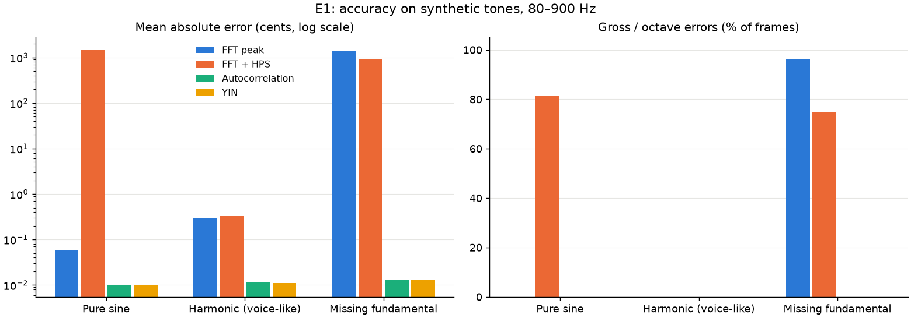
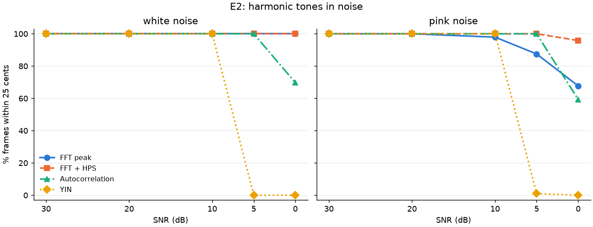
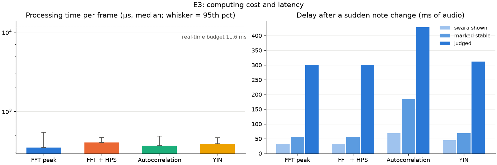
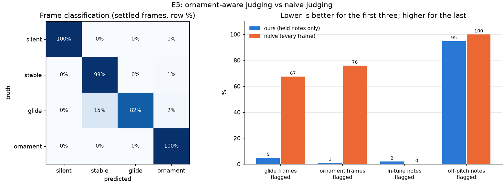
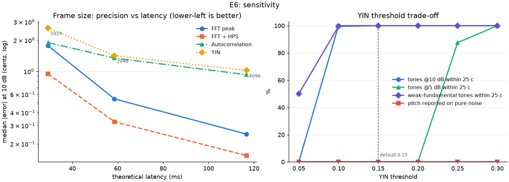

# Swara-Aware: evaluation results

Generated 2026-11-12 17:45 by `python scripts/run_all_experiments.py` in 55 s. Master random seed **2026**, so every number below is reproducible. The tanpura drone was **off** for every experiment. Python 3.11.9, numpy 2.4.6, Windows AMD64.

Default analysis settings: sample_rate=44100, frame_size=2048, hop_size=512, fmin=70.0, fmax=1000.0, silence_threshold_dbfs=-50.0, in_tune_cents=15.0, close_cents=30.0, stable_min_ms=250.0, yin_threshold=0.15.

## Key findings

- **E1, Accuracy on synthetic tones:** On harmonic tones all four methods averaged at most 0.3 cents of error. HPS fails on pure sines (gross errors on 81% of frames) because a sine has no harmonics to multiply. With the fundamental removed, FFT peak, FFT + HPS reported the wrong octave on most frames, while the time-domain methods kept their gross-error rate low (Autocorrelation 0%, YIN 0%).
- **E2, Noise robustness:** At 10 dB white noise: FFT peak 100%, FFT + HPS 100%, Autocorrelation 100%, YIN 100% of frames within 25 cents. At 0 dB, FFT peak held up best (100%). YIN fell to 0%: it said 'unvoiced' on 100% of those frames (its 0.15 threshold refuses to guess) rather than giving wrong pitches. Pink noise at 0 dB: FFT peak 68%, FFT + HPS 96%, Autocorrelation 59%, YIN 0%.
- **E3, Latency and computing cost:** Every method costs well under the 11.6 ms budget (slowest: FFT + HPS, 418 µs = 3.6%), so computing power is not the bottleneck: buffering is. After a sudden note change the new swara appears after 33–68 ms of audio and is judged after 300–428 ms. The estimated mic-to-display delay is about 149–183 ms (an estimate from components, not measured physically).
- **E4, Real voice vs pYIN reference:** Not run: no voice recordings were available.
- **E5, Ornament-aware logic:** Only 4.8% of glide frames and 1.0% of ornament frames were wrongly marked as errors (meends slower than 200 c/s: 24%, because the logic treats anything slower than the glide threshold as a held note; faster meends: 2%), against 67% and 76% for the naive judge-every-frame baseline. 95% of notes sung 30–45 cents off were flagged (naive: 100%), with 2% false alarms on in-tune notes. Settled frames were classified correctly 98% of the time; the weakest class is glide (82% recall), likely because short steps and the slow ends of meends look steady to a 120 ms window.
- **E6, Sensitivity: frame size and YIN threshold:** For YIN, going from 1024 to 2048 to 4096-sample frames raises latency 29 → 58 → 117 ms while the median error at 10 dB falls 2.6 → 1.4 → 1.0 cents; a 1024 frame also cannot reach notes below ~88 Hz (50% correct at 70–100 Hz). YIN threshold: at our default 0.15, 5 dB accuracy was 0% (it answers 'unvoiced'); at 0.30 it was 100% with 0% false voicing on pure noise and 0% octave errors on weak-fundamental tones. So in these synthetic tests a looser threshold cost nothing; we kept 0.15 because real voices add breath noise and consonants that synthetic noise does not, so the threshold should be re-checked on recordings (E4) before changing it.

## E1: Accuracy on synthetic tones

32 frequencies, log-spaced from 80 to 900 Hz; 5 random-phase frames each (frame 2048, 44100 Hz). MAE, median and max are over voiced frames; the gross-error rate is over all frames.

| Signal | Method | MAE (c) | Median (c) | Max (c) | Gross >600 c (%) | Voiced (%) |
|---|---|---|---|---|---|---|
| Pure sine | FFT peak | 0.1 | 0.0 | 0.7 | 0.0 | 100.0 |
| Pure sine | FFT + HPS | 1514.9 | 1873.7 | 2386.2 | 81.2 | 100.0 |
| Pure sine | Autocorrelation | 0.0 | 0.0 | 0.0 | 0.0 | 100.0 |
| Pure sine | YIN | 0.0 | 0.0 | 0.0 | 0.0 | 100.0 |
| Harmonic (voice-like) | FFT peak | 0.3 | 0.0 | 4.1 | 0.0 | 100.0 |
| Harmonic (voice-like) | FFT + HPS | 0.3 | 0.2 | 1.1 | 0.0 | 100.0 |
| Harmonic (voice-like) | Autocorrelation | 0.0 | 0.0 | 0.1 | 0.0 | 100.0 |
| Harmonic (voice-like) | YIN | 0.0 | 0.0 | 0.1 | 0.0 | 100.0 |
| Missing fundamental | FFT peak | 1396.5 | 1200.0 | 4333.5 | 96.2 | 100.0 |
| Missing fundamental | FFT + HPS | 900.8 | 1199.8 | 1200.4 | 75.0 | 100.0 |
| Missing fundamental | Autocorrelation | 0.0 | 0.0 | 0.1 | 0.0 | 100.0 |
| Missing fundamental | YIN | 0.0 | 0.0 | 0.1 | 0.0 | 100.0 |

**Finding.** On harmonic tones all four methods averaged at most 0.3 cents of error. HPS fails on pure sines (gross errors on 81% of frames) because a sine has no harmonics to multiply. With the fundamental removed, FFT peak, FFT + HPS reported the wrong octave on most frames, while the time-domain methods kept their gross-error rate low (Autocorrelation 0%, YIN 0%).

Files: `e1_accuracy.csv`, `e1_accuracy_detail.csv`, `e1_accuracy.png`

## E2: Noise robustness

Harmonic tones at 12 log-spaced frequencies (80–900 Hz), 8 frames each, per noise type and SNR. Values are the **% of frames voiced and within 25 cents**.

| Noise | Method | clean | 30 dB | 20 dB | 10 dB | 5 dB | 0 dB |
|---|---|---|---|---|---|---|---|
| white | FFT peak | 100 | 100 | 100 | 100 | 100 | 100 |
| white | FFT + HPS | 100 | 100 | 100 | 100 | 100 | 100 |
| white | Autocorrelation | 100 | 100 | 100 | 100 | 100 | 70 |
| white | YIN | 100 | 100 | 100 | 100 | 0 | 0 |
| pink | FFT peak | 100 | 100 | 100 | 98 | 88 | 68 |
| pink | FFT + HPS | 100 | 100 | 100 | 100 | 100 | 96 |
| pink | Autocorrelation | 100 | 100 | 100 | 100 | 100 | 59 |
| pink | YIN | 100 | 100 | 100 | 100 | 1 | 0 |

No recorded noise found in `data/noise/`; only synthetic white and pink noise were used. Add fan or traffic WAVs there and re-run to include them.

**Finding.** At 10 dB white noise: FFT peak 100%, FFT + HPS 100%, Autocorrelation 100%, YIN 100% of frames within 25 cents. At 0 dB, FFT peak held up best (100%). YIN fell to 0%: it said 'unvoiced' on 100% of those frames (its 0.15 threshold refuses to guess) rather than giving wrong pitches. Pink noise at 0 dB: FFT peak 68%, FFT + HPS 96%, Autocorrelation 59%, YIN 0%.

Files: `e2_noise.csv`, `e2_noise.png`

## E3: Latency and computing cost

Frame 2048 samples = 46.4 ms, hop 512 = 11.6 ms (the real-time budget per frame), 44100 Hz. Processing time is measured on 600 voiced frames on this laptop (Python, single thread). Theoretical latency = frame + hop + processing.

| Method | Mean (µs) | Median (µs) | 95th pct (µs) | % of hop budget | Theoretical latency (ms) |
|---|---|---|---|---|---|
| FFT peak | 375.8 | 350.0 | 542.8 | 3.2 | 58.4 |
| FFT + HPS | 417.7 | 405.6 | 468.4 | 3.6 | 58.5 |
| Autocorrelation | 383.6 | 369.2 | 484.4 | 3.3 | 58.4 |
| YIN | 402.1 | 389.3 | 462.3 | 3.5 | 58.5 |

**Detection delay**: a held Sa switches instantly to Pa, and the signal is streamed through the app's own `ProcessingWorker`. Times are audio time from the switch until the display shows Pa, until Pa is marked stable, and until it is judged (held for 250 ms).

| Method | Swara shown (ms) | Marked stable (ms) | Judged (ms) | Estimated mic→display (ms) |
|---|---|---|---|---|
| FFT peak | 33 | 57 | 300 | 149 |
| FFT + HPS | 33 | 57 | 300 | 149 |
| Autocorrelation | 68 | 184 | 428 | 183 |
| YIN | 45 | 68 | 312 | 160 |

**Estimated mic→display** = input-device latency reported by PortAudio for 'Microphone (Realtek(R) Audio)' (90.0 ms low / 180.0 ms high), plus the display detection delay, plus processing, plus half the UI poll interval (33 ms), plus half a 60 Hz screen refresh. This is an estimate added up from parts, **not** a physical measurement. To measure it physically: film the laptop screen and your mouth with a phone in slow motion (240 fps), sing a sudden loud note or clap a pitched instrument, and count the video frames between the sound starting and the trace changing (each frame = 4.2 ms). Repeat 10 times and take the median.

**Finding.** Every method costs well under the 11.6 ms budget (slowest: FFT + HPS, 418 µs = 3.6%), so computing power is not the bottleneck: buffering is. After a sudden note change the new swara appears after 33–68 ms of audio and is judged after 300–428 ms. The estimated mic-to-display delay is about 149–183 ms (an estimate from components, not measured physically).

Files: `e3_latency.csv`, `e3_latency.png`

## E4: Real voice vs pYIN reference

**pYIN is used as a reference, not as perfect ground truth.** Disagreement means one of the two trackers is wrong, not necessarily ours.

**Not run: no recordings found in `data/voice/`.** To run it, record WAV files of sustained notes, a scale (Sa to taar Sa and back) and a phrase with a meend, put them in `data/voice/`, and re-run `python scripts/run_all_experiments.py --only E4`.

**Finding.** Not run: no voice recordings were available.

## E5: Ornament-aware logic

20 seeded random phrases: 7 held notes each (30% of them sung 30–45 cents off on purpose, the rest within ±5 cents, all with up to ±8 cents of vibrato), joined by meends (0.3–0.7 s) or quick 60 ms steps; 25% of notes are followed by a gamaka (3.5–7 Hz, ±35–60 cents). Audio → YIN → ornament logic. 'Settled' frames are at least 150 ms from any segment boundary.

**Frame classification (settled frames)**: accuracy 97.6% (all frames: 85.7%).

| Truth \ predicted | silent | stable | glide | ornament | recall (%) |
|---|---|---|---|---|---|
| silent | 633 | 0 | 0 | 0 | 100.0 |
| stable | 0 | 7815 | 0 | 69 | 99.1 |
| glide | 0 | 182 | 988 | 30 | 82.3 |
| ornament | 0 | 2 | 6 | 2394 | 99.7 |

**Judging: ours vs a naive baseline** (a frame is 'flagged' if it is judged and more than 15 cents off; a note is 'flagged' if it is shown as close, sharp or flat):

| Measure | Ours (held notes only) | Naive (judge every frame) |
|---|---|---|
| Glide frames wrongly flagged as errors (%) | 4.8 | 67.3 |
|   of which quick step (60 ms) (n=285 frames) | 7.0 | 37.9 |
|   of which meend faster than 200 c/s (n=2520 frames) | 1.8 | 69.8 |
|   of which meend slower than 200 c/s (n=361 frames) | 23.5 | 73.4 |
| Ornament frames wrongly flagged as errors (%) | 1.0 | 75.9 |
| In-tune held frames flagged (false alarm, %) | 0.6 | 0.0 |
| Off-pitch notes (≥30 c, n=38) flagged (%) | 94.7 | 100.0 |
| In-tune notes (≤5 c, n=102) wrongly flagged (%) | 2.0 | 0.0 |

Of the off-pitch notes, 95% were shown as sharp/flat (beyond 30 c) and the rest as 'close'; the direction (sharp vs flat) was right for 95%; 5% were never judged. 9% of in-tune notes were never judged (too short after trimming, or misclassified).

**Finding.** Only 4.8% of glide frames and 1.0% of ornament frames were wrongly marked as errors (meends slower than 200 c/s: 24%, because the logic treats anything slower than the glide threshold as a held note; faster meends: 2%), against 67% and 76% for the naive judge-every-frame baseline. 95% of notes sung 30–45 cents off were flagged (naive: 100%), with 2% false alarms on in-tune notes. Settled frames were classified correctly 98% of the time; the weakest class is glide (82% recall), likely because short steps and the slow ends of meends look steady to a 120 ms window.

Files: `e5_ornament.csv`, `e5_frames.csv`, `e5_notes.csv`, `e5_ornament.png`

## E6: Sensitivity: frame size and YIN threshold

**Frame size.** Harmonic tones 100–900 Hz (clean and with 10 dB white noise), plus low notes at 70–100 Hz. % = frames voiced and within 25 cents. Latency = frame + hop + processing.

| Frame | Hop | fmin (Hz) | Method | Clean (%) | 10 dB (%) | Median err @10 dB (c) | 70–100 Hz (%) | µs/frame | Latency (ms) |
|---|---|---|---|---|---|---|---|---|---|
| 1024 | 256 | 88.3 | FFT peak | 95.8 | 84.4 | 1.8 | 25.0 | 273.6 | 29.3 |
| 1024 | 256 | 88.3 | FFT + HPS | 89.6 | 83.3 | 0.9 | 12.5 | 309.3 | 29.3 |
| 1024 | 256 | 88.3 | Autocorrelation | 100.0 | 100.0 | 1.9 | 50.0 | 347.5 | 29.4 |
| 1024 | 256 | 88.3 | YIN | 100.0 | 100.0 | 2.6 | 50.0 | 301.1 | 29.3 |
| 2048 | 512 | 70.0 | FFT peak | 100.0 | 100.0 | 0.5 | 75.0 | 466.4 | 58.5 |
| 2048 | 512 | 70.0 | FFT + HPS | 100.0 | 100.0 | 0.3 | 75.0 | 500.8 | 58.6 |
| 2048 | 512 | 70.0 | Autocorrelation | 100.0 | 100.0 | 1.3 | 100.0 | 434.5 | 58.5 |
| 2048 | 512 | 70.0 | YIN | 100.0 | 100.0 | 1.4 | 100.0 | 443.3 | 58.5 |
| 4096 | 1024 | 70.0 | FFT peak | 100.0 | 100.0 | 0.2 | 75.0 | 544.8 | 116.6 |
| 4096 | 1024 | 70.0 | FFT + HPS | 100.0 | 100.0 | 0.2 | 75.0 | 608.4 | 116.7 |
| 4096 | 1024 | 70.0 | Autocorrelation | 100.0 | 100.0 | 0.9 | 100.0 | 545.2 | 116.6 |
| 4096 | 1024 | 70.0 | YIN | 100.0 | 100.0 | 1.0 | 100.0 | 610.2 | 116.7 |

**YIN threshold** (silence gate off). Harmonic tones 80–900 Hz in white noise; 'weak-f0' = tones whose 2nd harmonic is ~7x stronger than the fundamental (clean and 10 dB), where a loose threshold could cause octave errors; 'false voiced' = pitch reported on 120 frames of pure white or pink noise at -20 dBFS.

| YIN threshold | ≤25 c @20 dB (%) | ≤25 c @10 dB (%) | ≤25 c @5 dB (%) | Voiced @5 dB (%) | Weak-f0 ≤25 c (%) | Weak-f0 octave err (%) | False voiced on loud noise (%) |
|---|---|---|---|---|---|---|---|
| 0.05 | 100.0 | 0.0 | 0.0 | 0.0 | 50.0 | 0.0 | 0.0 |
| 0.10 | 100.0 | 100.0 | 0.0 | 0.0 | 99.5 | 0.0 | 0.0 |
| 0.15 | 100.0 | 100.0 | 0.0 | 0.0 | 100.0 | 0.0 | 0.0 |
| 0.20 | 100.0 | 100.0 | 0.0 | 0.0 | 100.0 | 0.0 | 0.0 |
| 0.25 | 100.0 | 100.0 | 87.5 | 97.9 | 100.0 | 0.0 | 0.0 |
| 0.30 | 100.0 | 100.0 | 100.0 | 100.0 | 100.0 | 0.0 | 0.0 |

**Finding.** For YIN, going from 1024 to 2048 to 4096-sample frames raises latency 29 → 58 → 117 ms while the median error at 10 dB falls 2.6 → 1.4 → 1.0 cents; a 1024 frame also cannot reach notes below ~88 Hz (50% correct at 70–100 Hz). YIN threshold: at our default 0.15, 5 dB accuracy was 0% (it answers 'unvoiced'); at 0.30 it was 100% with 0% false voicing on pure noise and 0% octave errors on weak-fundamental tones. So in these synthetic tests a looser threshold cost nothing; we kept 0.15 because real voices add breath noise and consonants that synthetic noise does not, so the threshold should be re-checked on recordings (E4) before changing it.

Files: `e6_frame_size.csv`, `e6_yin_threshold.csv`, `e6_sensitivity.png`
